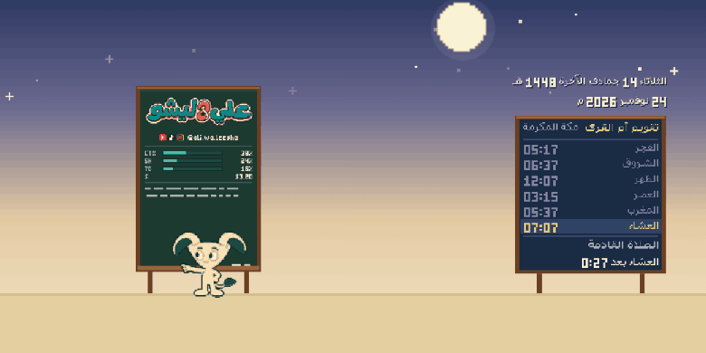
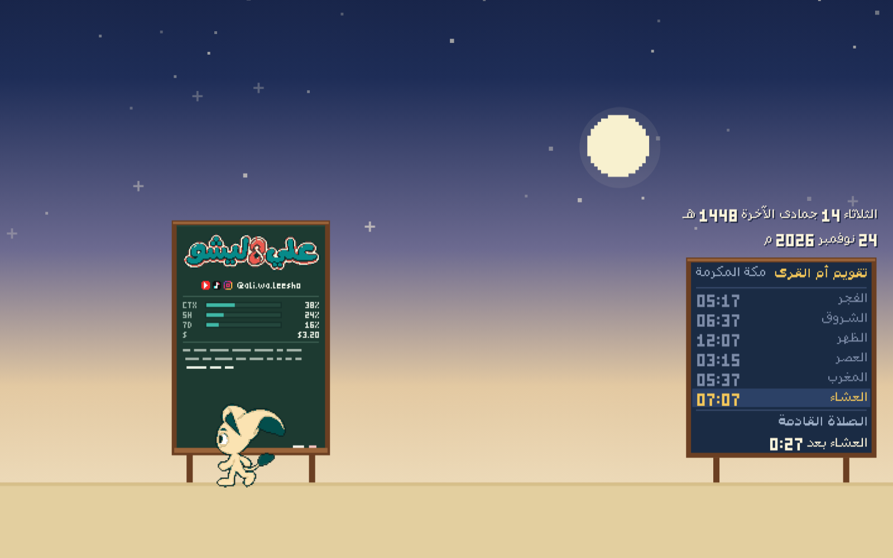
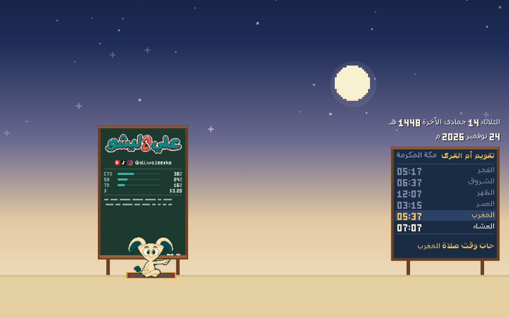

# Leesho — a pixel-art theme for Claude Code with prayer times

**Leesho Claude Theme** turns the Claude Code desktop app into a little pixel classroom at dusk. Leesho, the Ali & Leesho mascot, stands at a chalkboard and reacts to what Claude is doing: he thinks, writes, paces, cheers or facepalms. The chalkboard shows your live context use and plan limits. Beside it, a prayer-times board shows today's five prayers, the next prayer with a countdown, and the Hijri and Gregorian dates. It can alert you when a prayer comes in.

ثيم بكسل لـ Claude Code: ليشو يتفاعل مع شغل Claude قدّام سبورة، وجنبه لوحة مواقيت الصلاة بالتاريخ الهجري والميلادي. [اقرأ بالعربي ↓](#بالعربي)




## Features

- **A mascot that reacts to Claude.** Idle, thinking, writing while tools run, pacing on long turns, cheering when a turn ends, and a facepalm when a tool fails.
- **Live usage on the chalkboard.** Context fill, the 5-hour and weekly plan limits, and the session cost. Limits are shared between your open sessions, so an idle session doesn't show an old figure.
- **Prayer times, worked out offline.** Umm al-Qura (default) or Al-Hadi calendar, for 35 cities in Saudi Arabia, the Gulf, Iraq, Jordan and Yemen, or any latitude and longitude you give. No network calls.
- **Prayer alerts.** Every prayer, none, or the ones you choose. At prayer time Leesho sits on his prayer rug and knocks on the glass.
- **Hijri and Gregorian dates** above the prayer board: both, only one, or the board hidden altogether.
- **Readable replies.** Each reply sits on a soft glass box so text stays clear over the art. `/leesho glass 0-100` sets how opaque it is.
- **Fits any window.** The prayer board and moon follow the right edge when the window or a side pane narrows the view.

| Writing | Pacing | Prayer time |
|---|---|---|
|  |  |  |

## Install

In a Claude Code terminal session, type:

```
/plugin install leesho-theme --marketplace allawi951/leesho-claude-theme
```

Answer `y` to add the marketplace, then pick the user scope so the theme loads in every session. The next screen sets the options below.

From a shell:

```
claude plugin install leesho-theme --marketplace allawi951/leesho-claude-theme
```

In the desktop app: click **+** next to the prompt box, then **Plugins**, **Add marketplace** with `allawi951/leesho-claude-theme`, then **Add plugin**.

The scene draws in the Claude Code **desktop app** (and the mobile app). A terminal session runs the commands and alerts but has no backdrop to draw on.

**Nothing shows on Windows?** Turn on *Settings → Personalization → Colors → Transparency effects*. With it off, the app hides every backdrop, this one included.

## Options (chosen at install)

| Option | Values | Default |
|---|---|---|
| `calendar` | `ummalqura`, `hadi` | `ummalqura` |
| `city` | `makkah`, `madinah`, `riyadh`, `jeddah`, `dammam`, `khobar`, `dhahran`, `qatif`, `ahsa`, `jubail`, `hafar`, `kharj`, `buraydah`, `hail`, `taif`, `yanbu`, `tabuk`, `abha`, `khamis`, `baha`, `jazan`, `najran`, `arar`, `sakaka`, `kuwait`, `manama`, `doha`, `abudhabi`, `dubai`, `sharjah`, `muscat`, `baghdad`, `basra`, `amman`, `sanaa`, `custom` | `makkah` |
| `latitude`, `longitude`, `utcOffset` | numbers, used when `city` is `custom` | Makkah |
| `dates` | `both`, `gregorian`, `hijri` | `both` |
| `alerts` | `all`, `none`, or a list such as `fajr,dhuhr,maghrib` | `all` |
| `prayerBoard` | `true`, `false` | `true` |

Change them later from `/config`, or with the commands below.

## Commands

| Command | What it does |
|---|---|
| `/leesho` | Today's times, your calendar, city and alerts |
| `/leesho city riyadh` | Change the city |
| `/leesho calendar ummalqura` or `hadi` | Change the calendar |
| `/leesho date both`, `gregorian` or `hijri` | Which dates show |
| `/leesho board on` or `off` | Show or hide the prayer board |
| `/leesho alerts all`, `none` or `fajr,maghrib` | Which prayers alert you |
| `/leesho hijri -1` | Shift the Hijri date by up to 3 days |
| `/leesho glass 80` | Opacity of the glass box behind replies (0–100) |
| `/leesho test` | Show the prayer call for one minute, with its sound |

## Privacy

The theme makes no network requests. Prayer times, the moon and the Hijri date are computed on your machine. Usage figures come from Claude Code itself and stay in the plugin's local store. On Windows the prayer sound plays through a short local PowerShell call, because the app plays no plugin sound there.

Prayer times are calculated, not copied from an official table, so they can differ from your local mosque or calendar by a minute or two. `/leesho hijri` shifts the Hijri date if it is a day off.

## Credits

Made by **Ali & Leesho** — find us as `@ali.wa.leesho`. Prayer times use the standard solar formulas described by PrayTimes (praytimes.org), written fresh for this theme. The glass-knock sound is synthesized for this theme.

## License

The code is MIT-licensed. The Leesho character and the Ali & Leesho logo are not: see [LICENSE](LICENSE).

---

## بالعربي

**ثيم ليشو** يحوّل تطبيق Claude Code إلى فصل بكسل وقت المغرب. ليشو، شخصية «علي وليشو»، يوقف قدّام السبورة ويتفاعل مع اللي يسويه Claude: يفكّر، يكتب، يتمشّى، يفرح، ويحط يده على وجهه إذا فشلت أداة. السبورة تعرض استهلاك السياق وحدود الخطة وتكلفة الجلسة. وجنبها لوحة مواقيت الصلاة فيها الصلوات الخمس، والصلاة الجاية مع العدّ التنازلي، والتاريخ الهجري والميلادي.

### المميزات

- **ليشو يتفاعل مع Claude:** ينتظر، يفكّر، يكتب وقت ما الأدوات تشتغل، يتمشّى في الأدوار الطويلة، ويفرح إذا خلص الرد.
- **استهلاكك على السبورة:** السياق، وحد الخمس ساعات، والحد الأسبوعي، وتكلفة الجلسة. الأرقام مشتركة بين كل جلساتك المفتوحة.
- **مواقيت الصلاة بدون إنترنت:** تقويم أم القرى (الافتراضي) أو تقويم الهادي، لـ 35 مدينة في السعودية والخليج والعراق والأردن واليمن، أو أي موقع تحدده بخط الطول والعرض.
- **تنبيه الصلاة:** لكل الصلوات، أو بدون تنبيه، أو للصلوات اللي تختارها. وقت الصلاة يجلس ليشو على سجادته ويطق على الزجاج.
- **التاريخ الهجري والميلادي** فوق لوحة المواقيت: الاثنين، أو واحد منهم، أو تخفي اللوحة كلها.

### التركيب

في جلسة Claude Code في الطرفية اكتب:

```
/plugin install leesho-theme --marketplace allawi951/leesho-claude-theme
```

اضغط `y` لإضافة المتجر، واختر نطاق المستخدم (user) عشان يشتغل الثيم في كل الجلسات. بعدها تطلع لك شاشة تختار فيها:

- **التقويم:** أم القرى أو الهادي.
- **المدينة:** من القائمة، أو `custom` وتكتب خط العرض وخط الطول وفرق التوقيت.
- **التاريخ:** هجري وميلادي، أو ميلادي فقط، أو هجري فقط.
- **التنبيهات:** `all` لكل الصلوات، `none` بدون، أو تكتب الصلوات مثل `fajr,dhuhr,maghrib`.
- **لوحة المواقيت:** ظاهرة (الافتراضي) أو مخفية.

من تطبيق سطح المكتب: اضغط **+** جنب مربع الكتابة، ثم **Plugins**، ثم **Add marketplace** واكتب `allawi951/leesho-claude-theme`، ثم **Add plugin**.

تقدر تغيّر أي خيار بعدين بأوامر `/leesho` اللي في الجدول فوق.

### الخصوصية

الثيم ما يتصل بالإنترنت أبدًا. المواقيت والقمر والتاريخ الهجري تنحسب على جهازك، فممكن تختلف دقيقة أو دقيقتين عن التقويم الرسمي أو مسجد حيّك.

**ما يطلع الثيم في ويندوز؟** شغّل *Transparency effects* من الإعدادات ← التخصيص ← الألوان.
